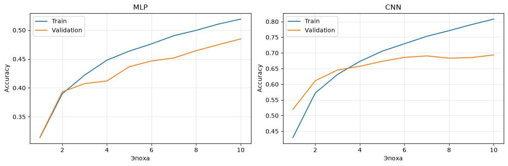
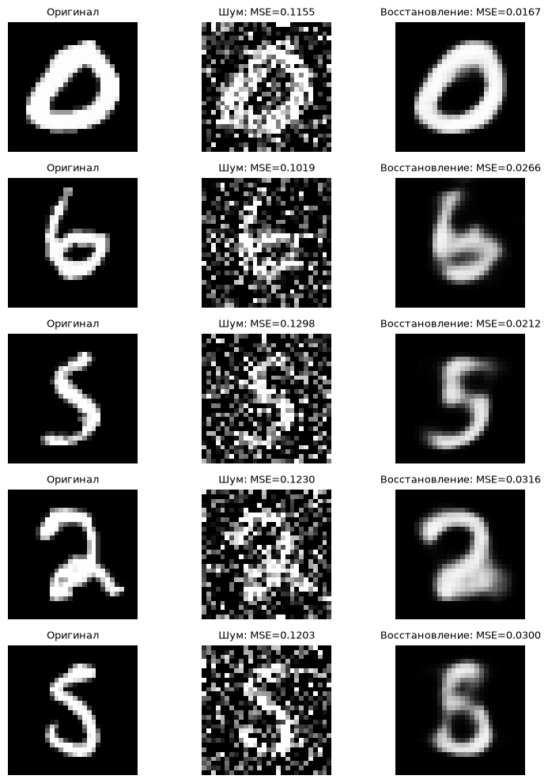

# Pattern Recognition & Deep Learning Experiments

Пять экспериментов с классическими алгоритмами распознавания изображений и нейросетями: от линейной регрессии на NumPy до вариационного автоэнкодера. Основной акцент — подготовка данных, оценка моделей, воспроизводимость и интерпретация результатов.

Код и пояснения находятся в notebooks. Для примеров используются синтетические данные, MNIST и CIFAR-10.

## Эксперименты

| Notebook | Задача | Методы |
|---|---|---|
| [01 — Gradient descent](notebooks/01_gradient_descent_from_scratch.ipynb) | Линейная регрессия на синтетических данных | MSE и градиентный спуск на NumPy, контроль через least squares |
| [02 — MNIST](notebooks/02_mnist_knn_svm.ipynb) | Классификация рукописных цифр | KNN и SVM с RBF-ядром |
| [03 — CIFAR-10](notebooks/03_cifar10_model_comparison.ipynb) | Классификация цветных изображений | KNN, линейный SVM, MLP и CNN |
| [04 — Denoising autoencoder](notebooks/04_denoising_autoencoder.ipynb) | Восстановление изображений MNIST с шумом | Свёрточный автоэнкодер, MSE до и после восстановления |
| [05 — Variational autoencoder](notebooks/05_variational_autoencoder.ipynb) | Восстановление и генерация цифр MNIST | VAE с двумерным кодом, reconstruction loss и KL divergence |

## Запуск

Требуется Python 3.12. Создайте отдельное окружение:

```bash
python -m venv .venv
```

В PowerShell установите зависимости и запустите JupyterLab из корня репозитория:

```powershell
.\.venv\Scripts\python.exe -m pip install -r requirements.txt
$env:KERAS_HOME = Join-Path (Get-Location) ".cache\keras"
.\.venv\Scripts\python.exe -m jupyterlab
```

В Linux/macOS:

```bash
.venv/bin/python -m pip install -r requirements.txt
KERAS_HOME="$PWD/.cache/keras" .venv/bin/python -m jupyterlab
```

Откройте notebook, выберите ядро этого окружения и выполните **Restart Kernel and Run All Cells**. Каждый notebook запускается самостоятельно. MNIST и CIFAR-10 скачиваются средствами Keras при первом запуске; требуется интернет. Данные сохраняются в `.cache/keras` и не добавляются в Git.

Полное обучение SVM и нейросетей может занять заметное время. В notebooks явно заданы seed, число эпох и размеры выборок.

## Условия оценки

- MNIST KNN/SVM: оба классификатора обучаются на одинаковых 60 000 изображениях и оцениваются на стандартных 10 000 test-объектах.
- CIFAR-10: из исходного train выделены 5 000 объектов для validation. KNN/SVM обучаются на 5 000 изображениях, MLP/CNN — на 45 000. У всех моделей одинаковый test из 10 000 объектов, но разные бюджеты обучения ограничивают сравнение архитектур.
- Автоэнкодеры MNIST: 54 000 train, 6 000 validation и 10 000 test. Test не используется при обучении.
- Denoising: качество восстановления сравнивается с ошибкой шумного входа на тех же изображениях.
- VAE: общая потеря включает reconstruction loss и KL divergence. Дополнительная MSE восстановления через средний код является отдельной метрикой.

Seed фиксирован, но версии библиотек и устройства могут влиять на результаты. Один запуск и выбранные параметры не дают универсального ранжирования методов. У автоэнкодеров сохранён учебный бюджет в одну эпоху.

## Результаты

Версии основных библиотек зафиксированы в [requirements.txt](requirements.txt).

### Классификация

| Данные | Модель | Train | Test accuracy |
|---|---|---:|---:|
| MNIST | KNN | 60 000 | 0.9627 |
| MNIST | SVM | 60 000 | 0.9792 |
| CIFAR-10 | KNN | 5 000 | 0.2727 |
| CIFAR-10 | SVM | 5 000 | 0.3100 |
| CIFAR-10 | MLP | 45 000 | 0.4838 |
| CIFAR-10 | CNN | 45 000 | 0.6997 |

Каждая accuracy вычислена на полном стандартном test-наборе из 10 000 изображений. CIFAR-10 имеет разные объёмы обучения у классических моделей и нейросетей; это ограничивает выводы о различиях архитектур.

### Линейная регрессия

| Метод | Обучающая MSE |
|---|---:|
| Градиентный спуск, 400 обновлений | 1.212067 |
| Метод наименьших квадратов | 0.806585 |

За заданные 400 обновлений градиентный спуск не достигает контрольного минимума. Ошибка измерена на синтетических обучающих данных; качество на новых наблюдениях здесь не оценивается.

### Автоэнкодеры

| Denoising autoencoder | Test MSE |
|---|---:|
| Шумный вход | 0.115886 |
| Восстановление модели | 0.023788 |

После одной эпохи средняя MSE снижена примерно на 79.5%. Модель восстанавливает общие контуры цифр, но сглаживает детали.

| VAE | Значение на test |
|---|---:|
| Общая loss | 175.975647 |
| Reconstruction loss | 171.279160 |
| KL divergence | 4.696514 |
| MSE восстановления через средний код | 0.054560 |

После одной эпохи VAE генерирует размытые формы, а большинство классов перекрываются в двумерном латентном пространстве. Обе части loss учитываются при обучении и оценке; качество генерации остаётся ограниченным.

### Графики

Кривые обучения MLP и CNN на CIFAR-10:



Удаление шума: оригинал, зашумлённый вход и восстановление:



Другие результаты:

- [Сходимость градиентного спуска](results/figures/gradient_descent.png).
- [Предсказания KNN и SVM на MNIST](results/figures/mnist_predictions.png).
- [Предсказания четырёх моделей на CIFAR-10](results/figures/cifar10_predictions.png).
- [Генерация VAE на сетке](results/figures/vae_latent_grid.png).
- [Латентное пространство VAE](results/figures/vae_latent_space.png).

[Метрики и условия запуска](results/metrics.json) содержат размеры выборок, параметры обучения, версии библиотек, контрольные суммы данных и кодовых ячеек.
